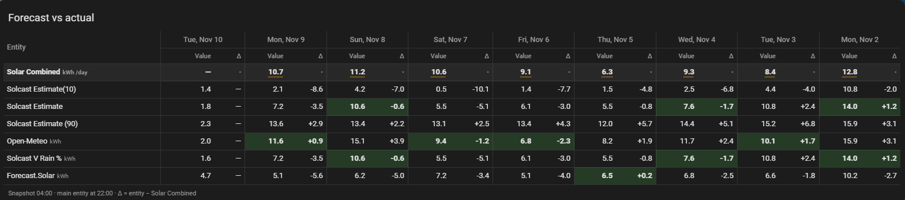

# Forecast Compare Card

[](https://www.buymeacoffee.com/boffy35)

A Home Assistant card that shows how good your forecasts really are. Each day it takes the forecasts at one time (for example 04:00, before the sun is up) and the actual result at another (for example 22:00, after sunset), then lays them out side by side with the difference for each forecast. The forecast that came closest each day is highlighted.

It works with any numeric entities: solar forecasts such as Solcast, Open-Meteo or Forecast.Solar against your inverter's generation, or temperature, rainfall or energy-use forecasts against what actually happened.



## Features

- **Rolling window** of 1 to 14 days. A new day is added each morning and the oldest drops off.
- **Nothing to set up or store.** Values are read from Home Assistant's history, so the table fills in straight away for the days you already have.
- **Separate times** for the forecasts and the actual, so the forecast is captured before the day starts and the actual once it's over.
- **Difference** for each forecast, as a value or a percentage, with the closest forecast each day highlighted in green.
- **Attributes as well as states.** Solcast's `estimate10`, `estimate` and `estimate90` can be compared from one sensor, and nested attributes such as `detailedForecast.0.pv_estimate` are supported.
- **Daily movement** for meters that keep counting up. It works out how much the meter rose each day, handling meter resets and ignoring brief glitches, which are marked with a dotted underline and explained when you hover.
- **Scaling** (×1000 or ÷1000) to compare Wh with kWh, with the unit relabelled to match.
- **Visual editor** for adding, reordering and removing forecasts.
- Tap an entity's name to open its details.

## Installation

### HACS (recommended)

1. Open **HACS** in Home Assistant.
2. Open the **⋮** menu (top right) and choose **Custom repositories**.
3. Add `https://github.com/Boffy35/forecast-compare-card` with the type **Dashboard**.
4. Search for **Forecast Compare Card** in HACS and download it.
5. Hard-refresh your browser (Ctrl + F5, or Cmd + Shift + R on a Mac).

### Manual

1. Download `forecast-compare-card.js` from the [latest release](https://github.com/Boffy35/forecast-compare-card/releases/latest).
2. Copy it to `/config/www/forecast-compare-card.js`.
3. Go to **Settings → Dashboards → ⋮ → Resources → Add resource** and enter:
   - URL: `/local/forecast-compare-card.js?v=1`
   - Resource type: **JavaScript module**
4. Hard-refresh your browser.

> [!NOTE]
> The card can only show days that Home Assistant still has in its history. The recorder keeps **10 days** by default, so to show more than 9 days, raise `purge_keep_days` in your [recorder settings](https://www.home-assistant.io/integrations/recorder/) to at least one more than `days`.

## How it works

For each day in the window, the card reads:

- **each forecast** at `snapshot_time`, for example the forecast for today as it stood at 04:00, and
- **the main entity** (the actual) at `main_time`, for example generation for the day as it stood at 22:00. If `main_time` isn't set, it uses `snapshot_time` too.

It then shows each forecast's value with **Δ = forecast − actual** beside it. A positive Δ means the forecast was too high; a negative one means it was too low.

Today's actual shows as **—** until `main_time` has passed.

### Value or daily movement

Each entity can be read in one of two ways, set with `calc` (or `main_calc` for the main entity):

| Setting | What it shows | Use for |
| --- | --- | --- |
| `value` | The reading at that time | Forecasts, temperatures, a "today" sensor that resets at midnight |
| `movement` | How much the reading rose over the 24 hours up to that time | Meters that keep counting up, such as lifetime or daily energy totals |
| `auto` (default) | `movement` for sensors with `state_class: total_increasing`, otherwise `value` | Most cases |

Movement is worked out from every reading in between, so it copes with a "today" meter that resets at midnight. A drop of more than 10% is treated as a reset; a drop that recovers within an hour is treated as a glitch and ignored. Small dips of under 10% are ignored as noise.

## Usage

Add **Forecast Compare Card** from the card picker and set it up in the visual editor, or use YAML:

```yaml
type: custom:forecast-compare-card
title: Forecast vs actual
main_entity: sensor.solar_energy_today
main_time: '22:00:00'
snapshot_time: '04:00:00'
entities:
  - sensor.solcast_forecast_today
  - sensor.forecast_solar_energy_today
```

The setup in the screenshot, with Solcast's three estimates, Open-Meteo and Forecast.Solar, is in [`examples/solar-forecasts.yaml`](examples/solar-forecasts.yaml).

## Options

### Card

| Option | Default | Description |
| --- | --- | --- |
| `title` | — | Card title. |
| `main_entity` | **required** | The actual: the entity the forecasts are compared against. |
| `main_name` | entity name | Name shown for the main entity. |
| `main_attribute` | — | Read an attribute instead of the state. |
| `main_calc` | `auto` | `auto`, `value` or `movement`. See above. |
| `main_scale` | `1` | `1000` or `0.001` to convert units. |
| `snapshot_time` | `06:00:00` | When the forecasts are read each day. |
| `main_time` | `snapshot_time` | When the main entity is read each day. |
| `days` | `7` | Number of days shown, 1 to 14. |
| `decimals` | `1` | Decimal places, 0 to 6. |
| `delta_mode` | `absolute` | `absolute` or `percent` (the difference as a percentage of the actual). |
| `show_main_row` | `true` | Show the main entity's row at the top. |
| `highlight_closest` | `true` | Highlight the forecast closest to the actual each day. |
| `color_deltas` | `false` | Colour positive differences green and negative ones red. |
| `newest_first` | `true` | Newest day on the left. Set `false` for oldest on the left. |
| `entities` | — | The forecasts to compare. See below. |

### Each forecast in `entities`

An entry can be just an entity ID, or a list of options:

| Option | Description |
| --- | --- |
| `entity` | The forecast entity. |
| `name` | Name shown in the table. |
| `attribute` | Read an attribute instead of the state. Use dots for nested values, such as `detailedForecast.0.pv_estimate`. |
| `calc` | `auto`, `value` or `movement`. |
| `scale` | `1000` or `0.001` to convert units. |

```yaml
entities:
  - sensor.forecast_solar_energy_today            # just the entity
  - entity: sensor.solcast_pv_forecast_forecast_today
    attribute: estimate90
    name: Solcast (90%)
  - entity: sensor.my_forecast_wh
    scale: 0.001                                  # Wh → kWh
```

Units are only shown for states, because an entity's unit describes its state, not its attributes.

## Support

If you find this card useful, you can [buy me a coffee](https://www.buymeacoffee.com/boffy35). Thank you!

## Licence

MIT, see [LICENSE](LICENSE).
